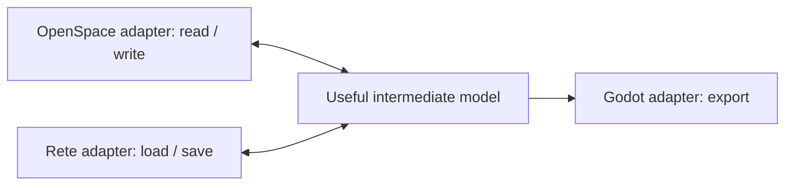

# Rust architecture

## Product contract

**Make a tool to repeatably port this OpenSpace game to Godot.**

The first supported game is Hype: The Time Quest, PC/OpenSpace Montreal. Godot is the primary product target: generated content should support a modern fan-remaster and provide a useful foundation for separately authored Godot work. OpenSpace reconstruction is both a strong validation tool and a modding capability. Importing arbitrary Godot edits back into Rete/OpenSpace is an optional later feature, not a prerequisite for the port.

This is the architecture for the Rust restart, agreed in direction on 2026-09-12. The module responsibilities and interfaces below are the implementation plan; they have not been implemented. Cargo crate packaging is a scaffolding decision. Read [rete-design.md](rete-design.md) for asset ownership and reconstruction rules, and [../plan.md](../plan.md) for ordered milestones and the format coverage matrix.

## Three modular I/O targets, one useful model

**The main architectural boundary is between the OpenSpace, Rete, and Godot import/export adapters.** Each owns its target's formats, I/O, configuration, and conversion rules. All three operate on one useful intermediate model, and application code composes their operations. This is the organizing principle for implementation and review.

The planned data flow is:

OpenSpace import and reconstruction are both planned. Rete loads and saves the model's serialized form. Godot export is the primary deliverable; importing Godot edits is optional future work. The diagram shows data flow, not adapter-to-adapter dependencies. A direct OpenSpace-to-Godot conversion can remain in memory, while a saved Rete model can feed either exporter through the same model contracts.

## Module boundaries

Preserve the following logical components whether they live in one library crate or several workspace crates. The earlier `astrolabe-model`, `astrolabe-openspace`, `astrolabe-rete`, and `astrolabe-godot` names are possible crate names, not a requirement to split immediately. Use ordinary modules for individual formats and domains.

| Component | Owns | Boundary |
| --- | --- | --- |
| `model` | The useful intermediate types; Level/Fix roots; typed file/member references; exact values; minimal source identity/order metadata; shared asset-resolution contracts | Shared by all adapters. May carry generic Serde derives and value utilities. Target I/O, format-specific encoding operations, and engine APIs belong to the adapters. |
| `openspace` | Hype source/profile detection, archives, compression, declarative binrw codecs, relocation context, import, and reconstruction | Reads/writes useful model values. Owns source encoding and export layout rules. Does not use Rete persistence or Godot internals. |
| `rete` | MessagePack persistence of the same model; schema envelopes, asset files, package roots, reference loading, and an asset cache | Loads/saves useful model values. Owns persistence choices and filesystem operations. Does not reconstruct OpenSpace VM state or depend on Godot. |
| `godot` | Resource naming, scenes, meshes, materials, animation, audio, behavior export, coordinate conversion, and Godot validation/build integration | Consumes useful model values and shared resolution contracts. Does not parse OpenSpace bytes or read private Rete layouts. Future Godot import belongs here if implemented. |
| `app` / CLI | Source/target selection, conversion sessions, diagnostics/reports, fixture orchestration, and commands | Composes adapter APIs and supplies shared model context. Keeps target codecs and conversion rules in their owning adapters. |

Adapters use the shared model and contracts without reaching into another adapter's implementation. For example, application code can supply an asset resolver backed by Rete files or an in-memory import session; the Godot adapter uses the same resolver contract in either case. Exercise each adapter with useful model fixtures independently, then test composed conversion paths at the application level.

These boundaries separate target operations while preserving one meaning and asset hierarchy. Rete is the serialized form of the intermediate model. Temporary headers, pointer fields, or target serialization records can support an encoding operation where necessary; a duplicate OpenSpace document hierarchy is not a prerequisite for useful content.

### Crate packaging and serialization traits

Choose a small library/CLI package arrangement during scaffolding that keeps the three adapter modules explicit. Separate crates are useful when their dependency or reuse benefits justify them; five crates are not an acceptance criterion. Do not create duplicate models or extensive wrappers solely to enforce a crate split.

Generic Serde derives may live with model types, optionally feature-gated if useful. The Rete adapter still owns MessagePack selection, schema envelopes, loading/saving, and filesystem I/O. The presence of a serialization trait on a shared type does not make that type responsible for a target pipeline. Rust's trait-placement rules apply at crate boundaries; modules in the same crate allow implementations to live apart from type definitions. If crates are split, use derives with the type or narrowly scoped adapters as needed; see [Serde's explanation](https://serde.rs/remote-derive.html). Keep actual OpenSpace encoding implementations in the `openspace` module and Godot operations in `godot`.

Keep adapter development focused on conversion and disposable test/development projects. Temporary Godot scripts, scenes, shaders, and behavior harnesses may exercise exported content; they are not an early commitment to a durable game runtime or asset API. Long-lived fan-remaster/game-parity assets and runtime integration belong to downstream projects that depend on Astrolabe, even if packaged together. Defer them until OpenSpace import/export, Rete load/save, and Godot export work for the supported game content. Godot reverse import remains optional. GDScript can support early harnesses; a Rust GDExtension is not required to start the tool.

## Library reuse and early delivery

After minimal workspace/interfaces, restore LZO compression/decompression, textures, and standalone audio before SNA level semantics. The user reports complete working texture/audio import in C#; preserving that capability is the reason for this order. These formats are outside the level package and provide regression baselines, but cannot alone establish the shared content interface. Keep compression/envelope primitives reusable without a scene graph; CNT/GF and APM/BNM import must not require relocation state. Independent sound definitions can accompany audio, with scene/perso bindings integrated later.

Prefer suitable existing crates for standard codecs. The initial evaluation shortlist is below; no dependency has been added or proven against the Hype corpus yet. Pin selected versions during implementation and compare real fixtures before adopting them.

| Concern | Candidate and boundary |
| --- | --- |
| LZO | [`lzokay`](https://docs.rs/lzokay/latest/lzokay/) supplies Rust compression/decompression. Test Hype streams and retain game envelope/checksum rules in the OpenSpace adapter. Compatible decoded data does not imply identical historical compressed bytes. |
| PNG | [`png`](https://docs.rs/png/latest/png/) supplies PNG encoding/decoding. CNT directories, GF interpretation, palette/alpha semantics, and GF reconstruction remain Astrolabe's responsibility. |
| WAV | [`hound`](https://docs.rs/hound/latest/hound/) supplies WAV encoding/decoding. BNM/APM layouts, custom Ubisoft MPEG framing, channel routing, delay trimming, and loops remain explicit adapter concerns. |

A standard MPEG decoder may be reused after adapting Ubisoft framing; verify the required layer/profile, sample counts, and output against the archived decoder and vgmstream. Keep that choice behind the audio codec boundary. Working compression and media conversion come early; exact LZO and lossy-media re-encoding fidelity are separate research gates. Indeo AVI conversion with FFmpeg is late Godot export work, with the output profile chosen through real playback tests.

## Canonical asset APIs

The useful meanings are the intermediate model. An OpenSpace content codec returns the same objects that inspection, Rete serialization, Godot export, and OpenSpace reconstruction use. Build types around content: `Texture`, `Material`, `Model`, `Animation`, `Family`, `Perso`, `Scene`, `Collision`, `Sound`, `SoundBank`, `SoundEvent`, `AiModel`, `Behavior`, and `Localization`. Each owns meaningful components and references independently shared assets. A model exposes vertices, submeshes, materials, bounds, and collision; a perso exposes family/model/state/behavior references and instance values.

The model represents OpenSpace's useful semantics faithfully, including dynamic animation hierarchy and object switching. Coordinate conversion, smoothing, quaternion normalization, mesh optimization, and approximations needed by Godot happen in the Godot adapter, without changing the canonical source values. Use exact numeric representations and tested conversions where quantization matters; do not hide encoded source blobs behind numeric accessors.

The shared contracts are deliberately small:

- `AssetRef<T>` identifies a file and optional member. Serde persists the reference, not an expanded object graph. A reference is not a VM pointer or an instruction to eagerly deserialize another file.
- Asset resolution returns the shared loaded asset for a reference. The conversion session can own most or all selected content in memory. On-demand loading operates at useful asset boundaries, not at every small engine struct.
- Root/package context distinguishes Fix, the selected level, textures, sounds, source edition, and locale. OpenSpace loads one level at a time. A session binds shared Fix content to that active level; a batch may process levels sequentially. Resolve Fix-to-level bindings in that session, without caching one level's binding as a global property of shared Fix content. Simultaneously active levels are not a runtime requirement.
- Import and export operations return structured diagnostics with asset paths, supported features, and context. Wire offsets may appear in diagnostics and local test reports without becoming canonical asset names.

Assess the interface with both standalone media and a small level-style dependency graph before committing to signatures. File boundaries and in-memory ownership should agree sufficiently that an inspector can explain an asset without understanding serialization internals. Record which choices are provisional, the evidence behind them, and the cases that would require revision; revisit these decisions before each new domain makes them expensive to change.

## Binary codecs with binrw

**Declarative format definitions describe how OpenSpace bytes encode the useful intermediate model.** Document and implement independent formats through a unified interface to that model. binrw is the planned binary codec foundation, not yet installed. Its [`BinRead`](https://docs.rs/binrw/latest/binrw/trait.BinRead.html) and [`BinWrite`](https://docs.rs/binrw/latest/binrw/trait.BinWrite.html) traits support the underlying read/write operations. Use shared declarations, value mappings, and composable helpers to make both encoding rules and their useful interpretation explicit.

Keep semantic field definitions in the model, with encoding rules, source evidence, and unresolved questions documented alongside their codec declarations. Express endianness, variants, conditional fields, counts, assertions, and derived write fields declaratively where practical. binrw supports [value mappings and custom field parsers/writers](https://docs.rs/binrw/latest/binrw/docs/attribute/index.html#map); use these to compose useful values and references. Reading a material should yield a meaningful texture link such as `texture:/path/stone` (an illustrative asset reference, with extension conventions still to be chosen), with pointer resolution handled inside the codec context. Writing that material derives the engine representation from its current values and minimal source metadata.

Direct decoding into existing model values is preferred when natural. Keep binrw-specific implementations in the `openspace` module. Within one crate, trait implementations may refer directly to types in `model`; use functions or local wrappers where a separate crate or the encoding calls for them. Wrapping a shared value does not require duplicating its fields. Introduce temporary wire records only when headers, packed values, discontiguous data, or layout calculations make them useful. No mandatory pair of wire and semantic structs is required for each type, and callers must not perform a second conversion to obtain the useful model. The declarations and helpers together constitute the content codec.

Reuse specialized compression, XOR, bitstream, reference, and pixel/sample helpers. Document the specific reason for imperative encoding logic, and keep ordinary layout rules declarative. Use bounded file or decompressed-memory views and validate sizes/counts/offsets before allocation or seeking. Low-level stream/envelope helpers can return bytes or headers internally; passing those tests demonstrates a primitive, not completed content support.

### Unified format interface

The common interface organizes **content files from packages, loaded into the useful model, converted, and saved through any supported target adapter**. Packages provide roots and reference context; useful assets provide the units callers load and save. The interface spans OpenSpace, Rete, and Godot. Keep the narrower binary codec contract inside OpenSpace, where binrw declarations and helpers implement individual encodings.

| Shared operation | Contract |
| --- | --- |
| Describe support | Identify a target/content format, supported profiles/versions, documentation, and explicit load/save capabilities. Godot export is required; reverse import remains optional. |
| Load content | A package-scoped content reference plus session context produces useful model values with identity and dependencies, or common diagnostics. Callers need not know source pointers or archive offsets. |
| Convert and save | Useful values plus dependency resolution, destination, and target options produce target files/packages or explicit unsupported-feature diagnostics. Application code selects and composes adapters. |
| Validate | Check useful values, reference resolution, target constraints, and reconstruction coverage using common diagnostic conventions. |

This is a shared behavioral contract, not a requirement to force all I/O into one trait or identical Rust signatures. Use small typed APIs and explicit context. A private OpenSpace `FormatCodec` can pair reads/writes of a useful type, component, or asset group over bounded binary views. Rete owns MessagePack loading/saving, and Godot owns its resource conversion; neither inherits relocation or binary-layout parameters.

For example, GF decoding yields a `Texture`, BNM decoding yields a `SoundBank`, and level decoding yields models/scenes with shared materials and family references. Rete persists these same values and Godot consumes them. A source archive member may hold one asset; a useful level asset may span discontiguous records or several source files. Content-file identity is therefore not a promise of one physical source file per asset. Export may assemble many assets into an OpenSpace package.

Share package/root context, I/O limits, asset resolution, supported-operation reporting, and diagnostic conventions. Keep OpenSpace source-address maps and export layout private to that adapter. Use filesystem references for persisted asset lookup and transient in-memory maps where useful. A small built-in format catalogue may support selection and inspection; no runtime plugin system, persistent database, or registry of every engine allocation is needed.

Before freezing signatures, exercise a small synthetic level-style example: forward/shared references, two distinct assets with equal values, Fix bindings to one active level, and a size-changing edit that requires derived export layout. If sessions reuse caches across batch conversion, check level A, then B, then A for stale bindings. This assesses the level requirements early without implementing the level parser ahead of the working media paths. Texture/audio codecs then refine the same contracts, not define their entire scope.

Run fixtures through one harness for meaningful decoded values, writes from expected/edited values, malformed data, supported operations, and reported coverage. Save/reload through Rete and check meaning, identity, and export behavior. Adding a format should primarily add documented useful fields, declarative encoding rules/helpers, and fixtures, allowing independent modules to advance together. All automated suites finish in under ten minutes, preferably much less.

Text formats such as CSB/LCB/SIF use suitable text parsing behind the same useful-value interface. LZO and media libraries handle payload algorithms. `nom` is not a planned parallel binary parsing foundation; a concrete text grammar may justify parser combinators. Serde/MessagePack supplies Rete persistence; Godot adaptation and OpenSpace reconstruction operate on that same model.

## OpenSpace adapter

Suggested modules are `profile`, `source`, `containers`, `relocation`, `import`, `export`, and domain modules such as `texture`, `geometry`, `animation`, `scene`, `audio`, and `ai`.

The Hype profile owns verified format rules: endianness, record layouts, compact transform encoding, alignment, block/header conventions, and relocation behavior. Select the supported profile from the actual source edition and configuration. Do not turn this into a general all-OpenSpace-games framework before Hype works.

Import uses source files, decompressed blocks, and transient address/relocation context to populate the useful model through the content codecs. Resolve sharing and assign minimal reconstruction order/identity information as part of that operation. A complete raw OpenSpace object graph is not a prerequisite. Source pointers and address maps stay within the import context. Reusable declarations and helpers jointly perform binary interpretation and useful asset construction.

Export proceeds from current semantic content:

1. Collect the selected assets and their dependencies; check reference identity and required coverage.
2. Lower assets into the engine records and buffers required by the supported Hype profile. Recover original pool order from minimal metadata where needed.
3. Derive encoding choices, sizes, alignment, placement, and virtual bases from content and verified profile rules. Compute actual pointer values from the resulting layout.
4. Emit records and generate relocation tables from the pointer fields actually written, including Fix-to-level bindings. Keep emission order deterministic; do not rediscover pointers by scanning arbitrary integers.
5. Generate headers/checksums and compress the resulting data with the selected encoder.

No export pass reads the original disc, stored RT tables, or original compressed bytes to substitute for reconstruction. A comparison harness may read original files as expected results; those files are not exporter inputs.

Encoding decisions and alignment are exporter logic, not fields copied from an import into metadata. If a byte mismatch suggests an unknown encoding or layout rule, investigate it and record the missing rule. Do not silently add per-object flags or original offsets as a shortcut. Meaningful source facts and explicitly unresolved data can remain represented, but their scope and incomplete understanding must be visible.

Exact pre-compression SNA/sidecar/relocation reconstruction is a target to prove. The historical near-match in LZO output is a separate known research item and does not block Godot work. Keep audio/image codec fidelity separate from LZO container fidelity; lossily decoded audio does not by itself establish that the original encoded stream can be recovered.

## Rete adapter

Rete is the serialized form of the intermediate model: persist the same useful asset types returned by OpenSpace codecs and consumed by Godot. There is no separately designed Rete asset hierarchy or semantic conversion on save/load. Persist each useful asset as one MessagePack file with a small versioned envelope and Serde data. Use named maps so inspection remains useful even though direct text editing is unnecessary. Prototype representative nested assets, embedded binary buffers, exact numeric values, and references to validate the schema and performance.

The filesystem provides asset lookup. Nested data stays within its owner; shared content has a reference. Keep dense arrays and raw byte buffers inside the same MessagePack asset, using numeric arrays or explicit binary fields as appropriate. Byte-buffer serialization must use MessagePack binary values rather than a sequence of individually encoded integers. Do not create generic `.bin` sidecars, a separate binary-content file, or a file per scalar/matrix/opaque span. Media assets must retain the useful values and minimal source facts needed for reconstruction. PNG/WAV are Godot output choices, not mandatory Rete representations. Use richer structured texture/audio data inside MessagePack wherever those formats would lose required information; see [media representation](rete-design.md#media-representation). Independently shared assets still have their own files. A small root manifest may identify package role, schema/profile version, roots, and conversion provenance; it is not an index of every runtime allocation.

Resolve references once per session as needed. Keep small lookup maps and dependency caches in memory. Do not add a persistent database, indexed container, or second authoritative cache. Benchmarks distinguish serialization time from filesystem operations and full conversion cost.

Rete persistence is optional in the direct port path. Both `OpenSpace -> model -> Godot` and `OpenSpace -> model -> Rete -> model -> Godot` use the same importer, canonical types, and Godot exporter. Their output must agree for the same inputs/options.

## Godot adapter and runtime

Start with native Godot scenes/resources: `.tscn` scenes, `.tres` materials/resources, and ArrayMesh geometry; PNG/WAV use Godot's import pipeline. One adapter owns resource writing. If measured mesh serialization costs later justify binary resources, change that writer behind the same adapter and use Godot's ResourceSaver rather than introducing a parallel asset pipeline. The first implementation must actually import and open its generated resources in Godot.

Temporary runtime harnesses test the export of engine behavior that a scene file alone cannot capture. Durable game-specific runtime assets are deferred to downstream projects after the adapter-readiness gate below. Preserve animation sample timing, channel relationships, mesh switches, family states, and event bindings. Implement AI from a typed behavior tree/IR with explicit action support and a scheduler; printing source-like scripts does not constitute a functioning port. Unsupported gameplay operations must be reported, not silently translated into no-ops. Visual-only partial milestones must be identified as such.

Godot's resource loader should access imported project assets. Godot keeps generated import caches under `.godot/imported`; those are engine-owned caches rather than Astrolabe's stable public interface. See the official [import process](https://docs.godotengine.org/en/stable/tutorials/assets_pipeline/import_process.html). Native resource serialization is supported by [ResourceSaver](https://docs.godotengine.org/en/stable/classes/class_resourcesaver.html), and [ArrayMesh](https://docs.godotengine.org/en/stable/classes/class_arraymesh.html) accepts structured vertex arrays.

## Development outputs and downstream projects

The final output should have a deterministic arrangement that independently authored Godot projects can depend on. That is an eventual public interface. **Do not implement long-lived converter-owned assets or establish durable downstream dependencies until OpenSpace import/export, Rete load/save, and Godot export all work for the supported game content.** Godot reverse import stays optional. A media-only demonstration does not satisfy this gate.

During adapter development, use disposable test/development scenes, scripts, shaders, behavior harnesses, and wrapper assets to verify conversion and regeneration. They may be kept as test fixtures but carry no promised game/runtime API stability. Keep naming and resource-mapping choices provisional while models and adapters are being tested; do not freeze path spelling in milestone 0.

After that gate, game-parity, full-working-game, and fan-remaster projects can establish durable assets and runtime contracts. Those projects depend on Astrolabe as the converter; Astrolabe is not the owner/originator of their game content. They may be packaged together without changing that ownership. Plan and version the generated resource/member paths, node identities, animation names, and integration APIs when actual downstream use can inform them.

Repeatability and safe regeneration still apply to development outputs:

- Derive reproducible asset/member names from source identity and meaningful ownership. Detect collisions. Avoid VM addresses, random IDs, timestamps, and traversal-dependent naming. Edits to values should not unnecessarily rename an asset.
- Process one selected level with shared packages at a time. Sequential batch conversions must not bake the first level's bindings into shared Fix assets. Compare single-level and batch results without assuming the engine has several active levels.
- Keep deterministic serialization where order has no semantic meaning, preserving meaningful array/child order. Record converter/schema/profile/locale/options and tool versions so a result can be reproduced. Revisit provisional mappings when the model changes.
- Verify Godot's import and UID behavior on the pinned version. Its caches are derived artifacts. The [ResourceUID API](https://docs.godotengine.org/en/stable/classes/class_resourceuid.html) does not by itself establish a cross-project identity contract.
- Track generated files, write completed results safely, and surface collisions. Regeneration must preserve unrelated or authored project files, including temporary test wrappers. Never silently overwrite those files or delete them as stale converter output.
- Keep extracted/game-derived assets and fixtures local. Reusable converter code and synthetic fixtures can be distributed independently of locally generated game content.

A later Godot importer can define an explicit supported subset of editable content. Do not promise that arbitrary Godot edits can be represented in OpenSpace.

## Application surface

The primary planned command is `astrolabe port <game-directory> <godot-project>`, with explicit level/locale selection as needed. It validates the source, imports the selected dependency closure, emits Godot content, invokes import validation, and writes a report. A clean repeat uses the same operation and reproduces the arrangement for that converter/schema version; a durable downstream contract is deferred as described above.

Supporting commands expose the same library operations: `import-openspace` saves Rete; `export-godot` consumes Rete; `export-openspace` rebuilds selected original-game files; `inspect` displays semantic assets; `validate` runs targeted comparisons. These are planned commands, not currently executable. Full asset decoding and Godot inspection should not wait for the whole package writer.

## Validation and local toolchain

Every automated test suite must complete in **under 10 minutes of wall-clock time**, with faster feedback preferred. Design fixture selection, engine startup, subprocess deadlines, and cleanup around that end-to-end budget. Optional integration/corpus suites have the same limit. Measure and report duration on the documented development/CI environment; see [the test policy](../plan.md#test-and-measurement-policy) for deadline and coverage requirements.

Layer evidence: exact unit/asset codec comparisons, actual Rete persistence, local source-file reconstruction, Godot resource import/opening, visual/behavioral comparison, and eventually whole-package bytes. Changes to supported asset values must survive save/load and have the intended exported effect.

Use the original engine and its decompilation as the source of truth, followed by Raymap. Raymap is usually the first practical reference to consult; C# and old research notes remain valuable regression/research material but require corroboration. See [reference authority and research workflow](../reference/README.md#reference-authority-and-research-workflow).

Run Godot import checks headlessly, then use rendering-capable checks where appropriate. Align scene, camera, animation time, locale, and relevant render settings for comparisons. Pixel-perfect images are a useful parity target and measurement, analogous to bitwise identity, but are not expected or universally required for Godot. Use structural, visual, timing, and behavioral evidence appropriate to the feature.

Original-engine tests are opportunistic: no milestone or universal suite should depend on the harness working in every situation. Use Raymap as the practical backup where it covers the feature, and combine decompilation-informed expectations, fixtures, byte checks, and Godot observations elsewhere. Report which runtime claims remain unverified; a fallback is not evidence of a game run. When the original engine can be exercised, start with `reference/Savefile_EN.zip`, verify the actual save path and loaded state, and use additional saves or narrow memory interventions only as needed. Archive integrity is verified; engine loading is not. See [runtime guidance](../reference/README.md#runtime-validation).

The official [Godot command-line documentation](https://docs.godotengine.org/en/stable/tutorials/editor/command_line_tutorial.html) supports headless workflows and `--import`, which waits for resource imports and exits. A successful headless import alone is not a rendering or gameplay test.

Read-only tool discovery on 2026-09-12 found Rust/Cargo 1.98.1 and Godot `4.7.2.stable.arch_linux.ed1daf0bf`, with Lutris and Wine also on PATH. Pin/document the first supported Godot build during implementation; PATH discovery is not a validated game installation, imported Godot project, or working harness.
